# Paperclip for Android

A native Android client for a self-hosted [Paperclip](https://github.com/paperclipai/paperclip) instance, for running an AI agent team from your phone. Built with Kotlin and Jetpack Compose.

It covers the board operator's daily loop: answer what agents ask, approve or decline, watch runs live, and decide what gets done next. It uses the same HTTP API and live-events WebSocket as the Paperclip web UI, so nothing needs to change on the server.

<p align="center">
  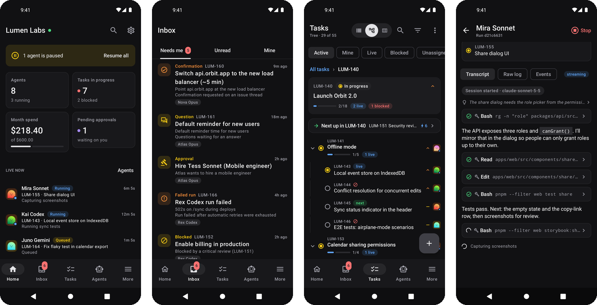
</p>

<p align="center">
  <a href="https://github.com/splitpierre/paperclip-android/releases/latest"><b>Download the latest APK</b></a> ·
  <a href="docs/USER_GUIDE.md">User guide</a> ·
  <a href="docs/DEVELOPMENT.md">Development</a>
</p>

> The screenshots show a made-up company served by the bundled [demo server](tools/demo-server), not real data.

## Highlights

- **An inbox of what needs you.** Agent questions, confirmations, approvals, failed runs and blocked work are collected in one feed. Swipe to dismiss, long-press to snooze.
- **Answer agents natively.** Questions (single choice, multiple choice or free text), confirmations including plan and tool-action approvals, checkbox choices, suggested tasks and item verdicts. Markdown, tables and code blocks render properly, so step-by-step instructions are easy to follow.
- **Tasks as a list, a tree or a board,** over a local copy of every task that live events keep up to date, so filtering and switching views is instant.
- **Next up.** For any branch of the tree, the app works out what can be started now (open, not waiting on a blocker, no open sub-tasks) and ranks it by priority and by how much other work it unblocks.
- **Live run transcripts** for Claude, Codex, ACP and Antigravity agents: messages, collapsible tool calls with their output, results and cost, streamed as they happen.
- **Agents, approvals, costs and quotas, projects, goals, routines, activity and search.** Pause, resume or wake agents, reset sessions, and read or edit their instruction files.
- **Notifications** for new items that need you, checked in the background about every 15 minutes.
- Light and dark themes. Works on Android 8.0 and later.

## Screenshots

### Inbox and agent requests

<table>
  <tr>
    <td width="33%">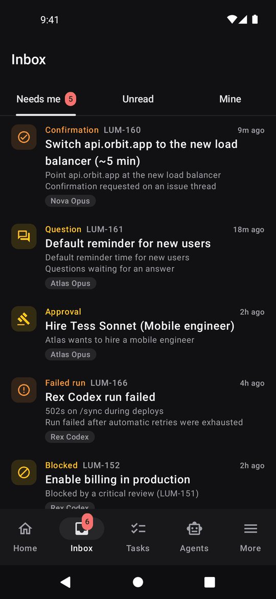</td>
    <td width="33%">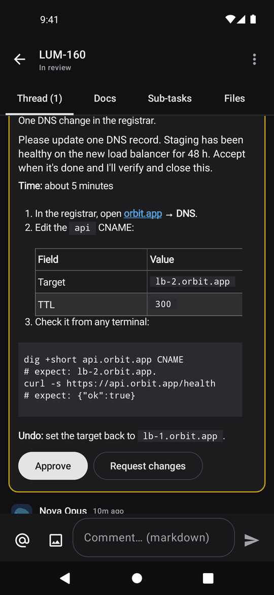</td>
    <td width="33%">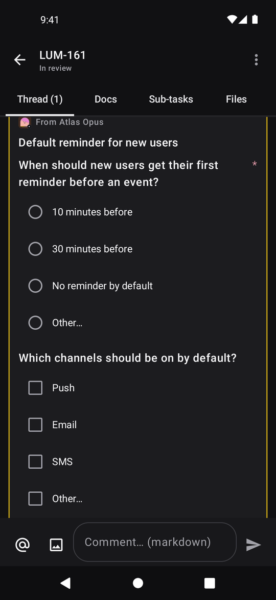</td>
  </tr>
  <tr>
    <td>Everything that needs you, in one feed.</td>
    <td>An agent asks for a 5-minute DNS change, with commands to check it and a way to undo.</td>
    <td>Agent questions, answered in place.</td>
  </tr>
</table>

### Tasks

<table>
  <tr>
    <td width="33%">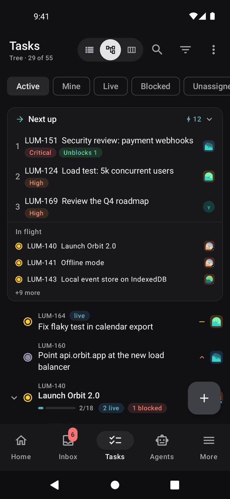</td>
    <td width="33%">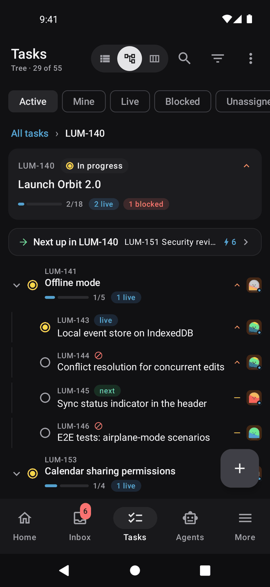</td>
    <td width="33%">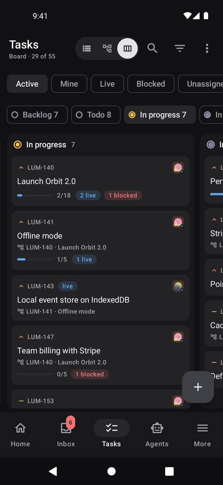</td>
  </tr>
  <tr>
    <td><b>Next up</b> ranks what can start now; <b>In flight</b> shows what's being worked on.</td>
    <td><b>Tree</b>, focused on one branch: progress, live runs, blockers and what's next.</td>
    <td><b>Board</b>: swipe between status columns. Cards show the parent and sub-task progress.</td>
  </tr>
  <tr>
    <td width="33%">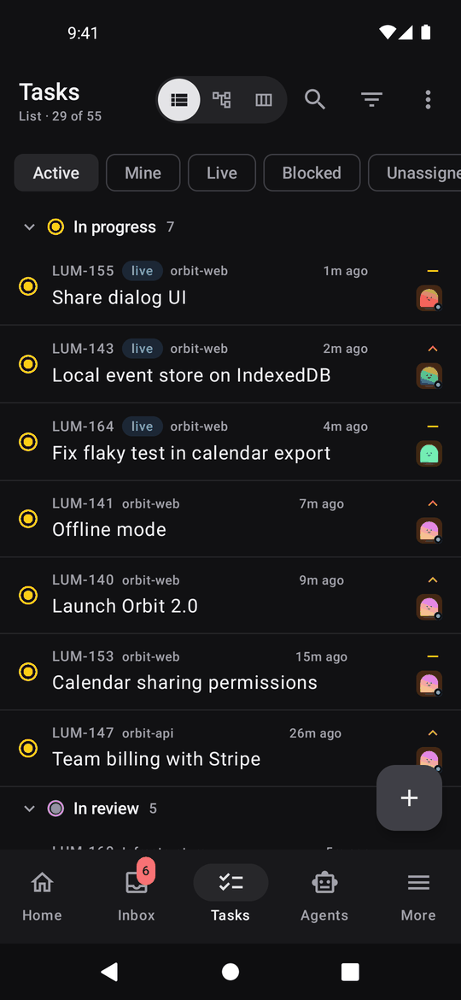</td>
    <td width="33%">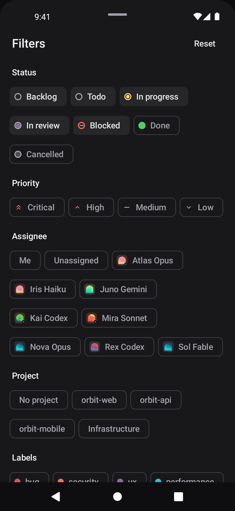</td>
    <td width="33%">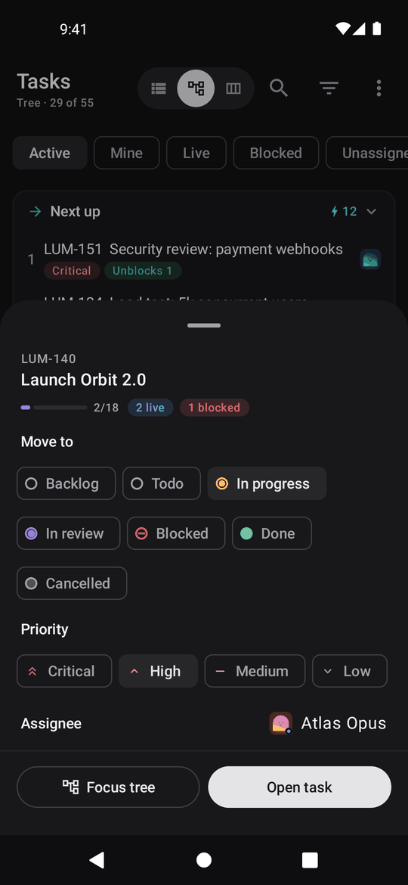</td>
  </tr>
  <tr>
    <td><b>List</b>, grouped by status, priority, assignee, project or parent.</td>
    <td>Filter by status, priority, assignee, project and label, or use a one-tap preset.</td>
    <td>Long-press any task to change its status, priority or assignee, or to focus its tree.</td>
  </tr>
</table>

### Agents, runs and costs

<table>
  <tr>
    <td width="33%">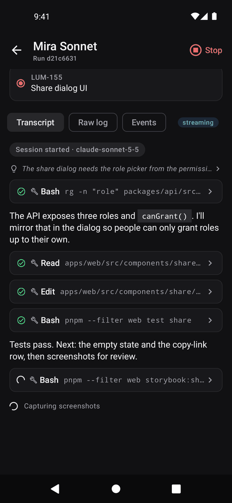</td>
    <td width="33%">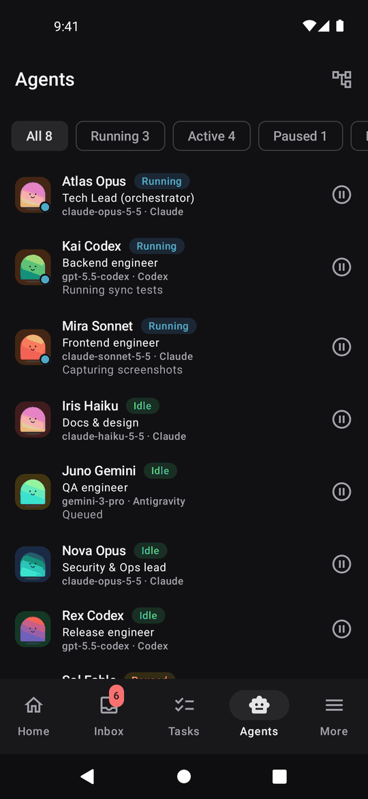</td>
    <td width="33%">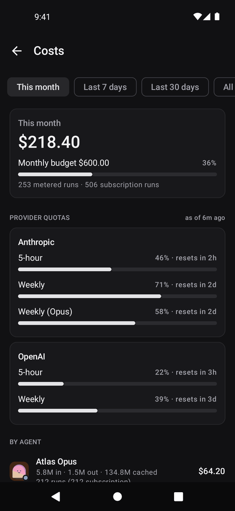</td>
  </tr>
  <tr>
    <td>A live run, streamed over the WebSocket.</td>
    <td>The team at a glance: status, model and what each agent is doing.</td>
    <td>Spend against budget, provider quota windows and cost per agent.</td>
  </tr>
</table>

### Light theme

<table>
  <tr>
    <td width="33%">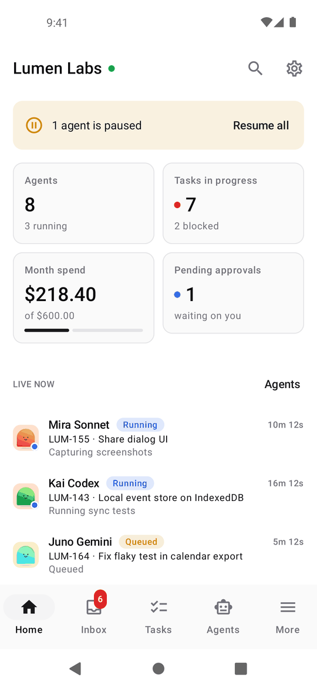</td>
    <td width="33%">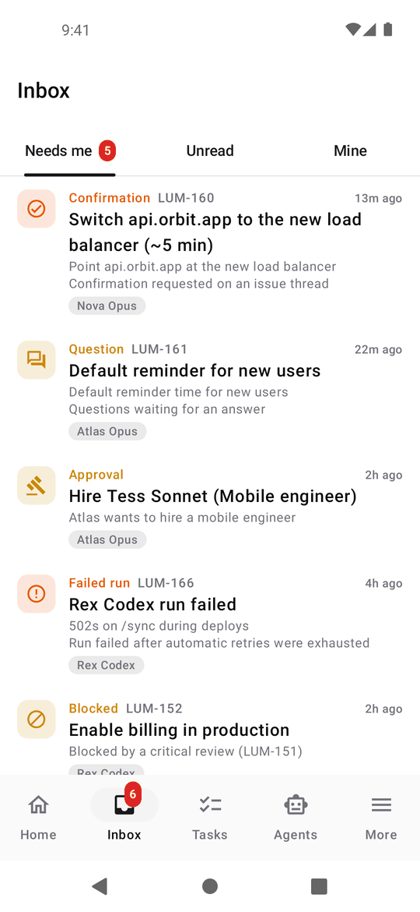</td>
    <td width="33%">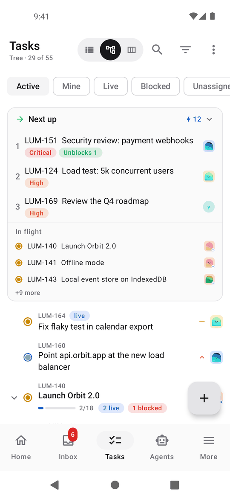</td>
  </tr>
</table>

## Install

1. On your phone, download `paperclip-android-<version>-debug.apk` from the [latest release](https://github.com/splitpierre/paperclip-android/releases/latest).
2. Open it, and allow installs from your browser or file manager when Android asks.
3. Enter your server URL (for example `https://paperclip.example.com`) and sign in.

New versions install over old ones and keep you signed in.

The server must accept the hostname you connect with. If you get a hostname error, run `paperclipai allowed-hostname <host>` on the server.

## Signing in

- **Email and password:** a native form signs in to Paperclip directly.
- **Behind Cloudflare Access or another sign-in proxy:** the app detects it and opens a browser for that step only, then carries on natively. API and WebSocket traffic reuse that browser's cookies.
- **Board API key:** paste a `pcp_board_…` key on the setup screen to skip sign-in. The live WebSocket only accepts cookie sessions, so in this mode the app polls for updates instead.
- If none of these fit, **Sign in with the web page instead** opens Paperclip's own sign-in page.

## Try it without a server

The [demo server](tools/demo-server) is a single Python file with no dependencies. It serves a made-up company with agents, a task tree, pending requests and live runs:

```bash
python3 tools/demo-server/demo_server.py --host 0.0.0.0 --port 3100
```

Point the app at `http://<your computer's IP>:3100` and sign in with any email and password. On an emulator, run `adb reverse tcp:3100 tcp:3100` and use `http://localhost:3100`.

## Building

You need JDK 17 or later and the Android SDK (platform 35 and build-tools 35).

```bash
echo "sdk.dir=/path/to/android/sdk" > local.properties
./gradlew assembleDebug
# app/build/outputs/apk/debug/app-debug.apk
```

See [docs/DEVELOPMENT.md](docs/DEVELOPMENT.md) for the architecture, tests, regenerating screenshots and cutting a release.

## Notes

This is an unofficial client and isn't affiliated with the Paperclip project. Releases are debug-signed builds for sideloading.
