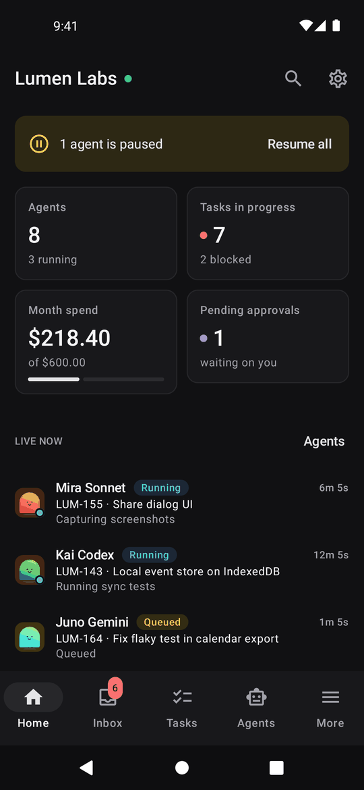

# User guide

How to get around Paperclip for Android. The app has five tabs: **Home**, **Inbox**, **Tasks**, **Agents** and **More**.

- [Home](#home)
- [Inbox](#inbox)
- [Answering agents](#answering-agents)
- [Tasks](#tasks)
- [A task's page](#a-tasks-page)
- [Agents and runs](#agents-and-runs)
- [More](#more)
- [Settings and notifications](#settings-and-notifications)
- [Live updates](#live-updates)

## Home

The dashboard shows the company at a glance:

- How many agents are running and how many tasks are in progress or blocked.
- This month's spend against the budget, and approvals waiting for you.
- **Live now**: every queued or running agent run, with the task it's on and what it's doing right now. Tap one to open its transcript.
- Run activity over the last two weeks and the latest activity.

If any agent is paused, a banner offers **Resume all**.

The dot next to the company name is green while the live connection is up and yellow while it reconnects. **Search** and **Settings** are in the top bar.

 

## Inbox

**Needs me** is the attention feed: anything waiting on you, such as agent questions, confirmations, plan approvals, hire approvals, failed runs and blocked work. Each row says what kind of item it is, why it's here and which agent raised it. Tap a row to go straight to where you can act on it.

- **Swipe** a row away to dismiss it. **Undo** brings it back.
- **Long-press** a row to snooze it for a while.

**Unread** lists tasks with activity you haven't seen. **Mine** lists tasks you're involved in.

The Inbox tab's badge counts what needs you.

 

## Answering agents

When an agent needs something from you, a card appears at the top of the task's thread. Cards waiting for you have a yellow border.

| Card | What you do |
|---|---|
| **Confirmation** | **Approve**, or **Request changes** with a reason. Plan approvals and tool-action approvals look the same. |
| **Questions** | Pick an option, several options or **Other…** with your own text, then submit. |
| **Choose options** | Tick the options you want and confirm. |
| **Suggested tasks** | Choose which proposed tasks to create. |
| **Review items** | Give each item a verdict. |

Card details are full Markdown, so tables, code blocks and links render as they do on the web.

 

## Tasks

The Tasks tab works from a local copy of every task in the company. It loads once, then fetches only what changed as live events arrive, so searching, filtering and switching views take no time.

The header shows the current view and how many tasks match, for example `Tree · 29 of 55`.

### Views

Switch views with the three icons in the header. The app remembers your choice.

| | |
|---|---|
|  | **List** groups tasks under collapsible headers. Group by status (the default), priority, assignee, project or parent, or not at all. |
|  | **Tree** shows parents and their sub-tasks. Each parent shows a progress bar (done out of total sub-tasks) and pills for live runs and blocked sub-tasks. Branches whose sub-tasks are all done start collapsed. |
|  | **Board** has one column per status. Swipe sideways, or tap a chip above the board to jump to a column. Cards show priority, assignee, parent task and sub-task progress. The Done column shows the 40 most recent. |

Markers you'll see on tasks:

- **live**: an agent is running on it right now.
- **next**: it's ranked in **Next up** for its branch.
- A red ⊘ next to the ID means it's waiting on an unfinished blocker.
- A dimmed task doesn't match your filters. It's shown so that a matching sub-task keeps its place in the tree.

### Next up

At the top of the tree, **Next up** lists what can be started now. A task qualifies when it:

- is **Todo** or **Backlog**,
- isn't waiting on a blocker that's still open,
- has no open sub-tasks of its own (otherwise its sub-tasks are the real next steps), and
- isn't under a cancelled parent.

They're ranked by priority, then by how many other tasks finishing it would unblock, then Todo before Backlog, then by task number. The pills explain the ranking: **Critical**, **High**, **Unblocks 2**, **Backlog** and **Unassigned**.

Below them, **In flight** lists what's in progress, in review or running right now.

Tap the header to collapse the card to a single line that still shows the top task.

 

### Focusing on one branch

Long-press a task and choose **Focus tree** to show only that task's sub-tasks. A breadcrumb at the top (**All tasks › LUM-140 › …**) takes you back up, and so does the back button. While focused, Next up and In flight only cover that branch.

### Quick edit

Long-press any task, in any view, to open the quick-edit sheet:

- **Move to** another status.
- Change the **priority** or the **assignee** (an agent, a person or nobody).
- See what it's **blocked by**.
- **Focus tree** or **Open task**.

Changes show immediately. If the server rejects one, the app puts it back and tells you why.

 

### Filters and presets

The chips under the header are one-tap presets:

| Preset | Shows |
|---|---|
| **Active** | Everything not done or cancelled (the default) |
| **Mine** | Tasks assigned to you |
| **Live** | Tasks with an agent running on them |
| **Blocked** | Blocked tasks, or tasks waiting on an open blocker |
| **Unassigned** | Open tasks with no assignee |
| **Done** | Done tasks |
| **All** | Everything |

The filter icon opens the full sheet: status, priority, assignee (including **Me** and **Unassigned**), project (including **No project**), label, live only, blocked only and hiding routine runs. It also sets the sort order (last updated, priority, created, task number or plan order) and the list grouping. Active filters show as chips you can remove one at a time, and the filter icon shows how many are on.

Use the search icon to match task IDs and titles. The **⋮** menu has **Expand all**, **Collapse all**, **Reset filters** and **Reload all tasks**.

 

## A task's page

The top of a task shows its title, status, priority, assignee and project. Tap any of these to change it. Below that are who created it, its cost, its number of runs and the description, which you can edit. If an agent is working on the task, a banner links to the live run.

The tabs are:

- **Thread**: agent request cards waiting for you, then the conversation in order, with older comments loaded on demand. Write comments in Markdown, @-mention agents or people, and attach images. Long-press a comment to copy it.
- **Docs**: the task's documents, such as plans. You can read and edit them.
- **Sub-tasks**: a tree of this task's sub-tasks with overall progress and **Next up** for this branch. **Show closed** adds finished sub-tasks. **New sub-task** is in the **⋮** menu.
- **Files**: attachments and work products such as pull requests.
- **Activity**: everything that happened to the task.

The **⋮** menu also has **Copy link**, **Open in browser** and **Mark unread**.

## Agents and runs

**Agents** lists the team with each agent's status, title, model and current activity. Filter by status, or tap the org-chart icon to see who reports to whom. The pause button pauses or resumes an agent.

An agent's page has four tabs:

- **Overview**: what it's running now, this month's spend, token totals, who it reports to, and its adapter details. Buttons at the top **Run now**, **Pause** or **Resume** the agent, or **Reset session**.
- **Runs**: recent runs and their outcomes.
- **Tasks**: open tasks assigned to the agent.
- **Instructions**: the agent's instruction files, which you can read and edit.

### Run transcripts

Open a run from Home, an agent's Runs tab or a task's live banner. **Transcript** shows the run as a conversation: the agent's messages, collapsed reasoning, and tool calls you can expand to see their input and output, with token counts and cost at the end. A live run streams as it goes; **Jump to latest** follows the output, and **Stop** cancels the run. **Raw log** and **Events** show the underlying data.

Transcripts support Claude, Codex, ACP and Antigravity agents. Output from other adapters shows as plain log lines.

 

## More

- **Approvals**: pending and past approvals, such as hiring an agent. Approve, reject or ask for a revision, with a note.
- **Projects**: each project's lead, target date and tasks.
- **Goals** and **Routines**. Routines can be run on demand or paused.
- **Costs & quotas**: spend against budget for this month, the last 7 or 30 days or all time; provider quota windows and when they reset; and cost by agent and by model.
- **Activity**: the company's activity feed, filterable by agents, people or the system.
- **Search** the company.

## Settings and notifications

Open **Settings** from Home or More:

- **Account**: who you're signed in as and whether the live connection is up.
- **Company**: switch between companies if you have more than one.
- **Appearance**: follow the system, or always use dark or light.
- **Notifications**: **Agent requests** checks about every 15 minutes for new questions, confirmations, approvals and failed runs, and posts a notification for each. Tapping one opens the item. **Check now** runs the check immediately.
- **Server**: the server URL and how you're connected. **Sign out** clears the app's Paperclip and sign-in proxy sessions.

## Live updates

While the app is open it keeps a WebSocket to the server, so new comments, status changes and run output show up without refreshing. If the connection drops, screens poll every 15 seconds until it's back, then catch up on anything they missed. Pull down on any list to refresh it by hand.

With a board API key the WebSocket isn't available, so the app polls instead.
